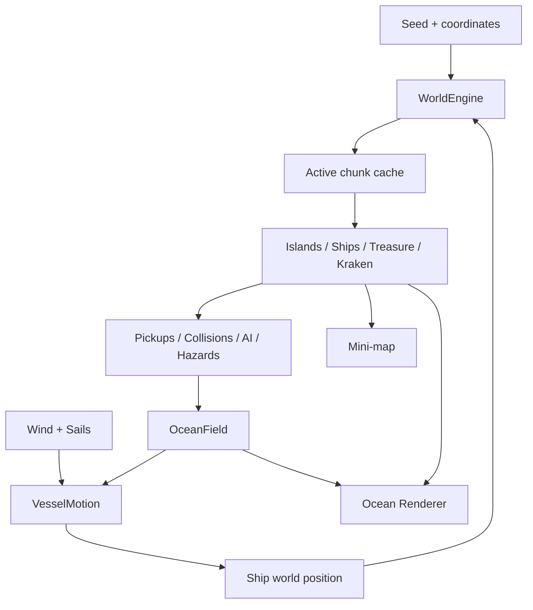

# All Aboard — Procedural World Contract (V0.4 Experiment)

**Status:** tested browser prototype, not an approved Unity feature.

**Goal:** An ocean that feels open-ended and makes short play sessions worth exploring, while preserving one-thumb sailing. Gameplay decisions remain simple; discovery and mastery arise from wind, geography, positioning, hazards and encounter choice.

## Generating the map

A 32-bit FNV-1a hash converts any JavaScript UTF-16 code-unit seed string into an integer, then a mixing function combines seed + signed chunk coordinates + generator version. Each chunk is independent: generation does not depend on the order in which chunks are visited. A 32-bit PRNG places small lists of features within the chunk.

- Seed field: share the seed text or use the `?seed=NAME` URL parameter (share links also include island/ship/treasure densities and Kraken toggle).
- World coordinates: lab units, not meters. Negative coordinates supported via mathematical floor.
- Chunk size: 540 × 540 lab units.
- Cache: 5 × 5 chunk neighborhood around the ship; distant chunks are evicted.
- Items (V0.4): organic small islands (sand/reef/palms), friendly and hostile ships, collectible treasure, rare Kraken.
- Spawn safety: the 0,0 starting area is kept free from solid island centers.
- Collected treasures and defeated NPCs have stable IDs within the session, not in permanent storage.
- Default Kraken chance: approx. 1.8% per eligible chunk (not near start). Manual summon is a **lab-only** test control.
- Generation version: V1. Future algorithm changes should increment the generator version to avoid silently changing known worlds.

This isn't a complete physics world. Chunk memory is bounded, but session-level collected/destroyed ID sets grow while exploring indefinitely. Persistent storage, pruning and save format remain future decisions.

## Independent modules

- `world.js`: pure seeded generation, bounded chunk cache, feature state, drawing, basic collision and Kraken effects.
- `ocean.js`: shared wind-oriented wave-height function; current/vortex sample and interactive splashes, bubbles, stern wake.
- `vessel.js`: hull forces, lateral resistance, sails, rudder and soft anchor line.
- `app.js`: browser UI, scene interactions and glue code. Unity should NOT reuse it directly.
- `flag-workshop.js`: pixel painter, local photo or GIF preview, selectable mast and PNG export.
- `mechanics-review.js`: decisions, local notes, Markdown export for Unity handoff.

## Water Engine: build our own, use references only

V0.4 retains our lightweight, original OceanField rather than buying/importing a water texture. We already sample wind-oriented, multi-frequency waves to create an organic world-space field. That single field powers the water color, small wave-gradient forces and visual vessel response. The vessel emits foam according to speed and turning; anchor release, cannon hits, shore collisions and Kraken activity emit localized ripples. Island beaches add a modest time-varying shoreline wash.

This should be **reactive**, not a repeating picture. It remains an arcade approximation: no depth-aware shallow-water PDE, no pressure solver, no true buoyancy or wave interference resulting from every entity. If performance and game feel justify a next step, trial a 128×128 or 256×256 height/velocity ripple buffer on top of the current ocean without replacing the whole engine.

### Performance guardrails

Keep the current world-space procedural water low resolution, upscaled smoothly. Update expensive fields at a lower frequency while drawing the ship/wheel at device refresh rate. Bound wake particles, cache a small chunk radius, and avoid per-frame full-world searches.

**Measure** median and p95 frame time, memory, input delay and browser haptics on a real mid-range Android phone. No FPS or speed benchmarks are asserted here without measurements.

## Interactions in V0.4

- Treasure: sails near an object → one contextual collection → coins once per world ID.
- Friendly ship: approach → single Hail action → opens the existing Friendly Encounter experiment. No ally formation yet.
- Hostile ship: automatic broadsides based on angle and range can damage and defeat nearby NPC vessels.
- Island: the hull has basic simplified boundary collision and generates water contact splashes.
- Kraken: rare or manually spawned, damages a ship that gets too close, can swallow NPCs, and disturbs the water.

Later (not implemented): Intercept mission, Rescue & Escort, allied fleet formation, Kraken boss fight, sophisticated island biomes and permanent world saves.

## Flag Workshop

- Choose **Front Mast** or **Rear Mast** for a mast-attached ship-local flag.
- Touch paint on a 48×32 pixel canvas; choose color/brush size, undo, erase, fill.
- Optional monogram, background color, local photo (PNG/JPEG/WebP) or animated GIF.
- GIF playback is a **browser DOM image overlay** positioned at the chosen mast, not a Canvas 2D animated sprite. Photos/GIFs stay in the browser (max 3 MB); nothing is uploaded to a server.
- Export a 256×160 PNG. For a GIF, PNG exports a still frame; a future Unity animation workflow would require frame extraction/spritesheet or another compatible importer.
- This is cosmetic: no change to wind or ship capability.

## Unity conversion and Mechanics Review

Decisions must come from joint playtests by Dor and Eilon, **not** from this prototype automatically. On the Mechanics Review tab, each mechanic is Test / Refine / Keep / Later / Reject with local notes. Export the Markdown brief after selecting the actual behavior you approve.

Recommended implementation boundaries:
- `WorldGenerator`: deterministic functions of seed/chunk/version only.
- `ChunkStreamer`: active chunks around player; pooling and eviction.
- `WorldObjectState`: stable IDs, collected/destroyed states, NPC identity.
- `OceanField`: shared water sampling and ripple emitter.
- `ShipMotionModel`: game-feel sailing with fixed timestep.
- `ShipFlagRenderer`: linked to front/rear mast transforms.
- `EncounterCoordinator`: aggressive or friendly, later escort/fleet missions.
- `DamageResolver`: part-specific health, ongoing fire/flood and repair turns.

Do not change Unity scenes, build profiles or repository settings until the mechanics are selected and accepted.

## Testing and QA

- `node tests/world.cjs`: reproducibility, negative coordinates, bounded cache, collected treasure persistence, Kraken and disabled densities.
- `node tests/vessel.cjs`: sailing, keel drag, anchor and ocean response.
- `node tests/smoke.cjs`: page wiring, basic interactions and simulated Canvas frames.
- Real-device visual testing is still required. Automated checks cannot prove water beauty or haptic feel.

References (for technique only): [seeded 2D worlds](https://github.com/danieljose/2dworld), [chunked deterministic generation](https://spin.atomicobject.com/infinite-procedurally-generated-world/), [procedural waves and shoreline research](https://onlinelibrary.wiley.com/doi/10.1111/cgf.14100). We did not copy those projects' source code.
